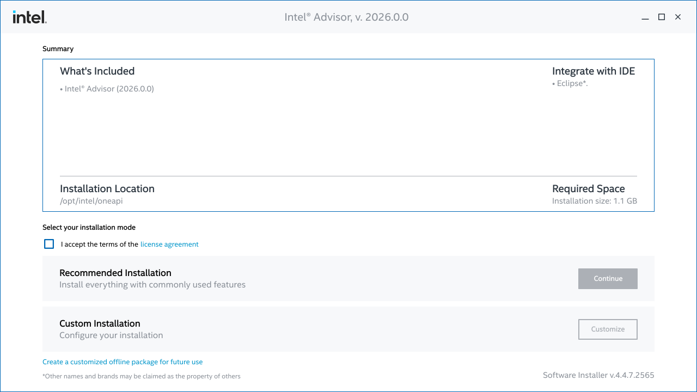
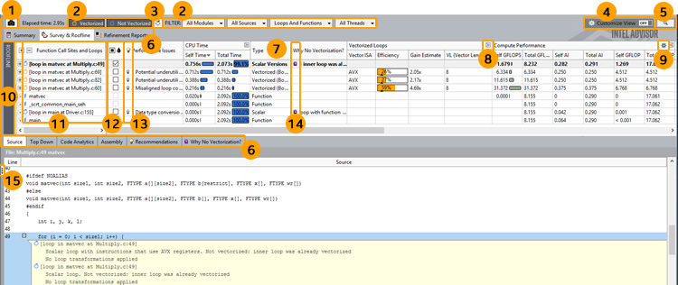

# Práctica 1

## Antes de nada 
* ¿Cómo saber el equipo disponible?
    * Modelo del procesador
    * Número de cores: 8 Performance-cores y 4 Efficient-cores
    * Vectorización: *sse*, *avx*...
    * Especificaciones a consultar en la página de [Intel](https://www.intel.com/content/www/us/en/products/sku/134591/intel-core-i712700-processor-25m-cache-up-to-4-90-ghz/specifications.html?wapkw=12700)

```console
user@lab:~ $  more /proc/cpuinfo 
...
processor : 0
...
model name : 12th Gen Intel(R) Core(TM) i7-12700
...
cpu cores : 16
...
...
flags		: ... avx ... avx2 ...
....
```

* Uso de P-cores o E-cores con `taskset`para fijar el core donde ejecutar
     * 0-15 usa P-cores
     * 16-19 usa E-cores

```sh
user@lab:~ $  taskset --cpu-list 0 python3 -c "import numpy as np, time; N=5000; A=np.random.rand(N, N); B=np.random.rand(N, N); start=time.time(); result=np.dot(A, B); end=time.time(); print(f'Execution time:', end-start, 'seconds');"
Execution time: 2.976552724838257 seconds
user@lab:~ $  taskset --cpu-list 16 python3 -c "import numpy as np, time; N=5000; A=np.random.rand(N, N); B=np.random.rand(N, N); start=time.time(); result=np.dot(A, B); end=time.time(); print(f'Execution time:', end-start, 'seconds');"
Execution time: 8.270392179489136 seconds
```


## Opciones de Compilación
* Opciones del compilador para llevar a cabo optimizaciones

## Autovectorización
* La opción **-O2** del compilador de [Intel® oneAPI DPC++/C++ Compiler](https://www.intel.com/content/www/us/en/docs/dpcpp-cpp-compiler/developer-guide-reference/2024-2/overview.html) habilita al autovectorizador: [O2](https://www.intel.com/content/www/us/en/docs/dpcpp-cpp-compiler/developer-guide-reference/2024-2/o-001.html) "Vectorization is enabled at O2 and higher levels."

```sh
user@lab:~ $ icx -o fooO2 foo.c -O2 -qopt-report=2
user@lab:~ $ more foo.optrpt 
....
LOOP BEGIN at foo.c (23, 2)
<Multiversioned v1>
    remark #25228: Loop multiversioned for Data Dependence
    remark #15300: LOOP WAS VECTORIZED
    remark #15305: vectorization support: vector length 2
LOOP END
```

## ¿Qué vamos a trabajar?
* Vectorización automática con compilador
* Vectorización semiautomática o guiada (programador)
* Vectorización manual o intrínsecas
* Herramientas de perfilado: Intel-Advisor

### Vectorización automática
* Detección de cuellos de botella
* Eliminación de operaciones de conversiones de datos
* Selección de flags de arquitectura
* Mejora de lay-out memoria

### Vectorización guiada por pragmas
* Las pragmas ayudan al compilador a tomar decisiones

```c
void axpy(float *c, float *a, float *b, float cte, int n)
{
	int i;
	#pragma vector aligned
	for (i=0; i<n; i++)
		c[i] = a[i] + cte*b[i];
}
```

### Vectorización manual con intrínsecas
* [Guía de Intrínsecas](https://software.intel.com/sites/landingpage/IntrinsicsGuide/)

```c
void axpy(float *c, float *a, float *b, float cte, int n)
{
	int i;
	__m128 sse_c, sse_a, sse_b, sse_cte;
	sse_cte = _mm_set1_ps(cte);
	
	for (i=0; i<n; i+=4){
		sse_a = _mm_load_ps(&a[i]);
		sse_b = _mm_load_ps(&a[i]);
		sse_b = _mm_mul_ps(sse_b, sse_cte);
		sse_c = _mm_add_ps(sse_a, sse_b);
		_mm_store_ps(&c[i], sse_c);
	}
}
```


# Ejemplos
## Opciones de compilación 
* Especifica las [optimizaciones en compilación](https://software.intel.com/en-us/cpp-compiler-developer-guide-and-reference-o): -O[n]
    * Por defecto el [compilador](https://www.intel.com/content/www/us/en/docs/dpcpp-cpp-compiler/developer-guide-reference/2024-2/o-001.html) utiliza **-O2**
* El código de ejemplo está [disponible](CompilerOpt/foo.c)

|   |   |
|---|---|
| **O0** |  Deshabilita cualquier optimización                                                   |
| **O1** |  Habilita optimizaciones que incrementan tamaño código pero lo acelera                |
|        |  Optimización global: analisis de flujo, análisis de vida de variables                |
|        |  Deshabilita inlining y uso de intrinsecas                                            |
| **O2** | **Activa vectorización**                                                              |
|        | Optimización a nivel de bucle                                                         |
|        | Optimización entre funciones                                                          |
| **O3** | O2+ Opt. más agresiva: fusión de bucles, unroll                                       |
|        | Adecuada para código basados en bucles y cómputo fp                                   |

[^1]: \url{}

## Opciones de compilación
* El código de ejemplo está [disponible](CompilerOpt/foo.c)
    * **O0**: Deshabilita cualquier optimización
    * **qopt-report=3** genera reporte en fichero foo.optprt
    * **-lm** enlaza con la librería matemática

```sh
user@lab:~ $ icx -o fooO1 foo.c -O1 -qopt-report=3 -lm
user@lab:~ $ more foo.optrpt 
Global optimization report for : get_time_milisec
=================================================================

Global optimization report for : foo

LOOP BEGIN at foo.c (23, 2)
LOOP END
...
```

    * Modificando la opción de compilación a **O2**: Activa vectorización, en el **reporte indica que en la línea 23** está vectorizado


```sh
user@lab:~ $ icx -o foo02 foo.c -O2 -qopt-report=3 -lm
user@lab:~ $ more foo.optrpt 
....
Global optimization report for : get_time_milisec
=================================================================

Global optimization report for : foo

LOOP BEGIN at foo.c (23, 2)
<Multiversioned v2>
    remark #15319: Loop was not vectorized: novector directive used
LOOP END

LOOP BEGIN at foo.c (23, 2)
<Multiversioned v1>
    remark #25228: Loop multiversioned for Data Dependence
    remark #15300: LOOP WAS VECTORIZED
    remark #15305: vectorization support: vector length 2
LOOP END

LOOP BEGIN at foo.c (23, 2)
<Remainder loop for vectorization>
LOOP END


....
```

## Cálculo potencial eléctrico
* Cálculo de potencial eléctrico, [código disponible](ElectricPotential/)
    * [Enlace al libro extraido](https://colfaxresearch.com/second-edition-of-parallel-programming-and-optimization-with-intel-xeon-phi-coprocessors/)
    * [Extraido del github!](https://github.com/ColfaxResearch/HOW-Series-Labs/tree/master/4/4.02-vectorization-data-structures-coulomb)

* 4 versiones
    * ver0: versión sin optimizar
        * Conviene prestar atención a las opciones de compilación (añadir arquitectura) y ver ineficiencias (conversiones de datos)
    * ver1: optimizado a la arquitectatura *target*, pero con ineficiencias de acceso a memoria (stride!=1)
        * Propuesta cambiar AoS por SoA
    * ver2: optimización de memoria
    * ver3: optimizacion de memoria a accesos alineados (*compilador no genera accesos alineados*)

# Tareas a realizar por el alumno
* Aplicar explotación SIMD utilizando la vectorización automática por parte del compilador en la aplicación de N-Body cuyo [código está disponible en el repositorio](NBody/)
    1. Vectorización autovectorizada
    2. Eliminación de "dependencias" en bucles (desalineación de punteros o \#pragma)
    3. Eliminación de conversión de tipos de datos (float/double)
    4. Accesos a memoria (**¿stride?**): SoA vs AoS
    5. Memoria alineada
* Uso de vectorización guiada porque en [algunos códigos](LU/) aparecen dependencias de datos aparentes que **inhiben la auyto-vectorización** por parte del compilador
    1. En el directorio "LU", al compilar con la opción de autovectorizacion (O2) y consultando el report del fichero fuente *lu.cc*, se puede ver el mensaje *vector dependence prevents vectorization* en la función que implementa la factorización LU: `LU_decomp`
    2. Se recomiendo usar alguna de las *pragma* estudias para "forzar" al compilador a generar código vectorial
```sh
LOOP BEGIN at lu.cc (14, 3)
    remark #15553: loop was not vectorized: outer loop is not an auto-vectorization candidate.

    LOOP BEGIN at lu.cc (15, 5)
        remark #15553: loop was not vectorized: outer loop is not an auto-vectorization candidate.

        LOOP BEGIN at lu.cc (17, 7)
            remark #15344: Loop was not vectorized: vector dependence prevents vectorization
            remark #15346: vector dependence: assumed FLOW dependence between A (18:13) and A (18:27) 
            remark #15346: vector dependence: assumed FLOW dependence between A (18:13) and A (18:16) 
            remark #25439: Loop unrolled with remainder by 4
        LOOP END

        LOOP BEGIN at lu.cc (17, 7)
        <Remainder loop>
        LOOP END
    LOOP END
LOOP END
```

* Programación con Intrínsecas haciendo uso de la [Guía de Intrínsecas](https://software.intel.com/sites/landingpage/IntrinsicsGuide/) 
    * El código a utilizar está en el [directorio Intrinsics](Intrinsics/)


# Intel-Advisor
[**Intel Advisor**](https://www.intel.com/content/www/us/en/developer/tools/oneapi/advisor.html) es una herramienta de análisis de rendimiento e ingeniería software diseñada para ayudar a desarrolladores a optimizar el rendimiento de sus aplicaciones en arquitecturas Intel (CPUs, GPUs y FPGAs). Forma parte del conjunto de herramientas **Intel oneAPI Rendering Toolkit / Base Kit**.

## Funciones Principales
* **Análisis Roofline (Roofline Analysis):**
    * Visualiza los límites teóricos del hardware frente al rendimiento real de la aplicación.
    * Identifica si el cuello de botella de la aplicación está limitado por la memoria (*Memory-bound*) o por la capacidad de cálculo (*Compute-bound*).

* **Vectorización (Vectorization Advisor):**
    * Identifica bucles y regiones de código que se benefician del uso de instrucciones SIMD (AVX-512, AVX2, etc.).
    * Muestra por qué ciertos bucles no se vectorizan y sugiere cambios específicos en el código para habilitar la vectorización.

* **Descarga a GPU (Offload Advisor):**
    * Analiza el código ejecutado en CPU e identifica qué partes del programa obtendrían ganancias significativas al trasladarse a aceleradores o GPUs.
    * Modela los costes de transferencia de datos y estimaciones de aceleración (*speedup*) antes de realizar el escalado a hardware dedicado.

* **Análisis de Flujo de Datos y Dependencias:**
    * Realiza análisis de dependencias entre datos (*Data Dependency Analysis*) para detectar de manera segura posibles condiciones de carrera en bucles paralelos.
    * Muestra la huella de memoria (*Memory Access Patterns - MAP*) para comprender patrones de acceso contiguos o no contiguos.

## Instalación
* Se puede descargar una versión "stand-alone" del [repositorio de Intel](https://www.intel.com/content/www/us/en/developer/tools/oneapi/advisor-download.html)
* Seleccionando el sitema Operativo **Linux** y el instalador "Offline Instaler" 
* Se pincha el enlace "Continue as a Guest (download starts immediately)" que habilita la descarga
* Una vez disponemos el fichero "intel-advisor-XXXX_offline.sh", ejecutar en una consola el instalador: `sh ./intel-advisor-XXXX_offline.sh`




    1. Tras seguir lo pasos previos, se llega a la pantalla de instalación "Welcome" donde **hay que aceptar los terminos de la licencia** y pulsar "**Recomended Installation**"
    2. No se desea la integración en el IDE de Eclipse "Skip Eclipse IDE configuration"
    3. Seleccionar la opción "I do NOT consent to the collection of my information"
    4. Se procederá a la instalación en la ruta por defecto `$HOME/intel/oneapi`

## Utilización
* Antes de poder usar la herramienta, conviente cargar la variables de entorno ejecutando el script "setvars.sh": `source $HOME/intel/oneapi/setvars.sh`
* En la consola se puede ejecutar la herramienta con `advisor-gui`
    * Creación de un proyecto con su nombre
    * Selección del ejecutable del proyecto 
    * Selección de análisis a realizar: **Vectorization and Code Insights** o **CPU/Memory Roofline Insights**

